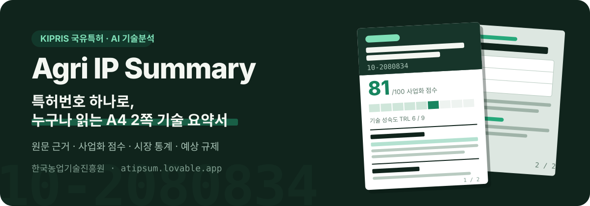
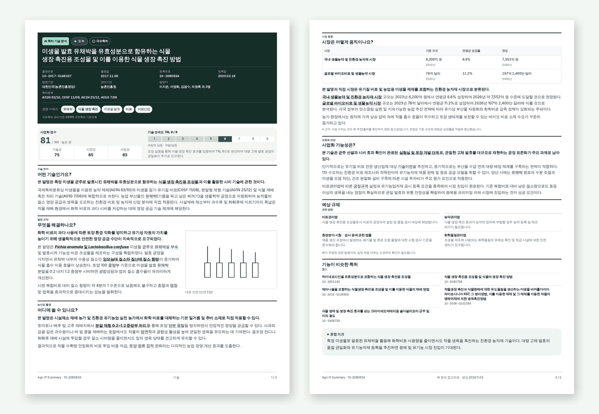
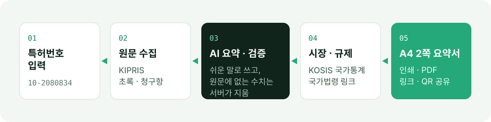

  

  <a href="https://atipsum.lovable.app"><b>서비스 열기</b></a> ·
  <a href="#사용법">사용법</a> ·
  <a href="#요약서가-만들어지는-과정">작동 방식</a> ·
  <a href="#주요-기능">주요 기능</a>

# Agri IP Summary (AIS)

농업 국가연구기관의 국유특허를 AI가 원문 근거로 읽고, 누구나 이해할 수 있는 **A4 2쪽 요약서**로 정리해 기술이전과 사업화 상담을 돕는 웹 서비스입니다. 한국농업기술진흥원이 운영하며, 설치·회원가입·로그인 없이 PC와 휴대폰 브라우저에서 바로 씁니다. 개인정보는 받지 않고, 방문과 검색은 횟수만 셉니다.

## 실제 결과물

  

특허 `10-2080834`를 넣었을 때 나오는 요약서를 그대로 인쇄한 두 쪽입니다(도면은 저장소용 대체 그림). 화면, 인쇄, PDF 다운로드가 모두 같은 내용의 **A4 정확히 2쪽**으로 나오며.

- **1쪽 · 기술**: 특허 기본정보와 관련 키워드 → 사업화 점수·기술 성숙도(TRL) → 어떤 기술인가요? → 무엇을 해결하나요?(대표 도면) → 어디에 쓸 수 있나요?
- **2쪽 · 시장과 사업화**: 시장 표(기준 규모·연평균 성장률·전망)와 근거 주석 한 줄 → 사업화 가능성 → 예상 규제(법령 링크) → 기능이 비슷한 특허 → 종합 의견
- **읽기 쉽게**: 비전문가가 읽을 수 있는 말로 쓰되 성분·균주·수치·청구 대상 같은 원문의 사실은 바꾸지 않습니다. 절마다 3~5곳을 강조해 굵은 글씨만 이어 읽어도 핵심이 보입니다.
- **공유**: 링크 복사, 이메일, QR 코드로 보냅니다.

## 요약서가 만들어지는 과정

  

AI가 쓴 글을 그대로 내보내지 않도록 서버가 먼저 걸러 냅니다.

- **원문 근거**: 기술 서술은 특허 원문(명칭·초록·청구항)에 있는 내용만 씁니다. 원문에 없는 효과 수치는 생성 뒤 서버가 지우고, 활용 분야는 청구항에 적힌 것과 명세서의 일반 용도를 구분합니다.
- **시장 수치**: KOSIS 국가통계나 관리자가 검수한 값이면 '공식 통계', 출처를 확인하지 못한 값이면 'AI 추정'입니다. 이 구분은 시장 절 아래 주석 한 줄로 밝히고, 같은 시장은 언제 봐도 같은 값이 나오도록 고정합니다.
- **규제**: 예상 규제에는 법령 원문 링크와 "실제 적용은 소관부처 확인 필요" 안내를 붙입니다.
- **상담·추천**: 특허 상담과 나만의 특허찾기는 실제로 검색된 특허 안에서만 답하고 추천합니다.

## 사용법

설치나 가입 없이 운영 주소에서 바로 씁니다.

1. https://atipsum.lovable.app 을 엽니다.
2. 첫 화면 검색창에 특허번호(예: `10-2080834`)를 넣으면 요약서가 열립니다. 처음 만들 때는 수십 초가 걸리고, 그 뒤로는 저장본이 바로 뜹니다.
3. 'PDF 다운로드'나 인쇄로 A4 2쪽을 받고, 링크 복사·이메일·QR 코드로 공유합니다.
4. 검색창에 문장(예: `토마토 생육을 촉진하는 미생물 비료`)이나 질문을 넣으면 조건에 맞는 특허 목록과 대화형 특허 상담이 나옵니다.
5. 위쪽 메뉴에서 나만의 특허찾기, 무상기술이전, 인사이트, 일괄조회, 관심특허 등 다른 기능으로 옮겨 갑니다.

## 주요 기능

| 메뉴 | 주소 | 하는 일 |
| --- | --- | --- |
| 통합검색 (홈) | `/` | 키워드, 문장, 질문을 검색창 하나로 받습니다. 특허번호는 요약서로, 짧은 단어는 넓은 검색으로, 설명형 문장은 조건에 맞는 특허만 골라 보여 주고, 질문은 그 자리에서 대화형 특허 상담으로 답합니다. |
| AI 특허 요약서 | `/?patent=번호` | 특허번호 하나로 A4 2쪽 요약서를 만듭니다(아래 '요약서' 참고). |
| 나만의 특허찾기 | `/finder` | 업종과 아이템을 넣으면 검색된 후보 안에서 맞는 특허를 골라 추천합니다. |
| 무상기술이전 | `/potential` | 무상으로 이전받을 수 있는 특허 목록을 모아 보여 줍니다. |
| 출원도우미 | `/filing` | 아이디어 정리 → 비슷한 특허 찾기 → 특허 가능성 진단 → 서류 만들기 → 제출하고 챙기기 5단계로 출원 준비를 돕고, 제출용 묶음 파일(zip)과 변리사 상담 요약서(.docx)를 만듭니다. 지금은 비공개이며, 관리자가 켜야 메뉴와 화면이 열립니다. |
| 인사이트 | `/insights` | 연도별·기술분야별 출원 동향과 주요 키워드를 보여 줍니다. |
| 일괄조회 | `/batch` | 여러 특허를 한 번에 조회하고 엑셀로 내려받습니다. |
| 관심특허 | `/compare` | 담아 둔 특허를 모아 나란히 비교합니다(브라우저에만 저장). |
| 기술소개영상 | `/tech-videos` | 농식품 주요 기술을 영상으로 소개합니다. |

기술이전 신청은 농업기술실용화 정보(NATI)로 바로 연결합니다. 이 사이트는 신청서나 연락처를 받지 않습니다.

<b>관리자 페이지</b> (<code>/admin</code>)

- **콘텐츠**: 추천 특허, 공지사항
- **홈페이지**: 문구, 홈 섹션 보이기, 기술소개영상, 기능 켜고 끄기(출원도우미는 기본 꺼짐)와 출원도우미 주소
- **요약서**: 섹션 제목·분량, 프롬프트 보충, 사업화 점수·TRL 기준, 시장 표준값 검토(AI 추정 값 승인)
- **출력**: 인쇄 섹션, PDF 배치
- **시스템**: 요약서 캐시 관리, 인기 특허 요약서 미리 생성, 이용·방문 통계, 만족도 결과, 관리자 비밀번호

## 알려진 제약

- 특허·통계·법령은 KIPRIS·KOSIS·국가법령정보 공개 API에 의존합니다. 해당 기관에 장애가 있으면 일부 항목이 늦게 나오거나 비어 있을 수 있습니다.
- 요약서를 처음 만들 때는 수십 초가 걸립니다. 한 번 만든 요약서는 저장되어 바로 뜹니다.
- 시장 규모는 대응하는 국가통계가 없으면 'AI 추정'으로 표시되는 참고값이고, 예상 규제는 소관부처 확인이 필요합니다.
- 출원도우미는 개발 중인 기능이며 결과물은 참고 자료입니다. 특허 출원이나 등록을 보장하지 않으므로 출원 전에 변리사 검토가 필요합니다.

## 오픈소스

React, Vite, Tailwind CSS, shadcn/ui, Supabase JS, jsPDF, html2canvas 등 MIT·ISC·Apache-2.0·BSD 계열의 허용형 라이선스 구성요소를 씁니다.
